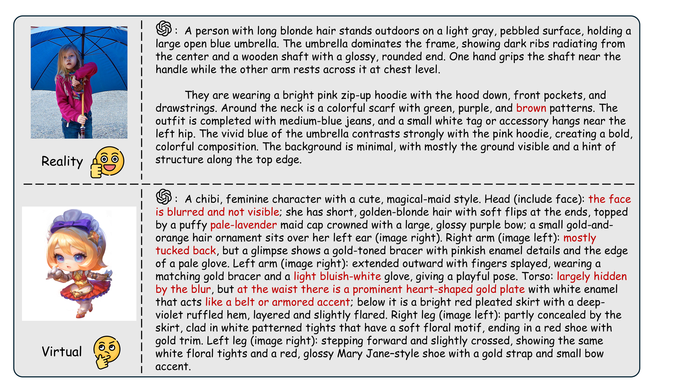
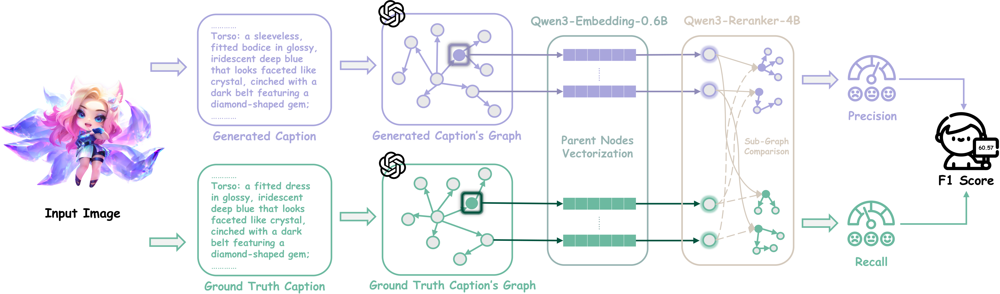

<p align="center">
  
</p>

<h1 align="center">A Game Character Caption Generator</h1>

<p align="center">
  <b>Game Character Captioning with Graph-based Evaluation</b>
</p>

<p align="center">
  <a href="https://aclanthology.org/2026.acl-long.248/">📄 Paper (ACL 2026)</a> •
  <a href="#-gc-bench-benchmark">GC-Bench</a> •
  <a href="#-gc-cap-model">Model</a> •
  <a href="#-quick-start">Quick Start</a> •
  <a href="#-graph-f1-evaluation">Evaluation</a>
</p>

---

## 📖 Abstract

While Large Vision-Language Models (LVLMs) have demonstrated remarkable proficiency in image captioning, existing research primarily focuses on real-world scenarios, leaving surreal, highly stylized, and semantically hybrid virtual-world scenarios significantly underexplored. In this work, we introduce **Game Character Captioning**, a novel task designed to evaluate LVLMs' capability to perceive and describe game characters from the virtual world. To facilitate evaluation, we establish **GC-Bench**, a manually annotated benchmark, and propose **Graph-F1** to effectively assess performance on this task. Our evaluation reveals that: (1) current state-of-the-art LVLMs, including closed-source giants such as Gemini 3 Pro and GPT-5.1, struggle to maintain the high performance seen in real-world scenarios; and (2) a notable gap exists between open-source and closed-source models. To bridge this gap, we construct **GC-148K**, a large-scale dataset generated via a specialized data pipeline, and develop the **GC-Cap** series. Experiments demonstrate that GC-Cap series rivals the performance of advanced closed-source models at a lower cost, offering an efficient solution for industrial-grade production environments.

<p align="center">
  
</p>
<p align="center"><i>Figure 1: GPT-5.1's caption performance in real-world and virtual-world scenarios.</i></p>

## 🤗 GC-Cap Model

The **GC-Cap** series are specialized LVLMs fine-tuned for game character captioning, rivaling advanced closed-source models at a lower cost.

| Model | Base Model | HuggingFace |
|---|---|---|
| GC-Cap-8B | Qwen3-VL-8B | 🤗 [AZYoung/GC-Cap-8B](https://huggingface.co/AZYoung/GC-Cap-8B) |
| GC-Cap-32B | Qwen3-VL-32B | 🤗 [AZYoung/GC-Cap-32B](https://huggingface.co/AZYoung/GC-Cap-32B) |

## 📊 GC-Bench Benchmark

**GC-Bench** is the first benchmark dedicated to **Game Character Captioning**, containing **186** manually annotated game character images across **6 artistic styles**:

| Style | Description |
|---|---|
| **Chibi** | Super-deformed / cute chibi-style characters |
| **Chinese Style** | Characters with traditional Chinese aesthetics |
| **Fantasy** | Fantasy-themed characters (warriors, mages, etc.) |
| **Military** | Military / tactical style characters |
| **Realistic** | Realistic / semi-realistic character renders |
| **Sci-Fi** | Science fiction themed characters |

Each image is annotated with:
- ✍️ Human-written ground truth captions
- 🔗 Pre-extracted ground truth entity-relationship triples (RDF-style)

## 🏗️ Project Structure

```
GC-Cap/
├── Eval/                          # Core evaluation code
│   ├── caption_generator.py       # Generate captions from LVLMs for evaluation
│   ├── eval.py                    # Graph-F1 evaluation pipeline
│   └── prompt_content.py          # Prompt templates for entity-relationship extraction
├── GC-Bench/                      # GC-Bench benchmark dataset
│   ├── Chibi/                     # Chibi style character images
│   ├── Chinese_Style/             # Chinese style character images
│   ├── Fantasy/                   # Fantasy style character images
│   ├── Military/                  # Military style character images
│   ├── Realistic/                 # Realistic style character images
│   ├── Sci-Fi/                    # Sci-Fi style character images
│   └── GC-Benchmark_*.csv         # Ground truth annotations
├── Scripts/                       # Shell scripts for running experiments
│   ├── caption_generate.sh        # Script for batch caption generation
│   └── eval.sh                    # Script for Graph-F1 evaluation
├── Fig/                           # Figures and logos
└── README.md
```

## 🔧 Installation

### Requirements

- Python 3.10+
- CUDA-compatible GPU (for Graph-F1 evaluation with embedding/reranking models)

### Install Dependencies

Run the provided install script (recommended):

```bash
bash install.sh
```

### Required Models (for Graph-F1 Evaluation)

The Graph-F1 evaluation pipeline requires the following models from Hugging Face:

- **Embedding Model**: `Qwen/Qwen3-Embedding-0.6B`
- **Reranking Model**: `Qwen/Qwen3-Reranker-4B`

These will be automatically downloaded on first run.

## 🚀 Quick Start

Evaluating a model on GC-Bench involves two steps: **(1) Generate captions** for the benchmark images, then **(2) Evaluate** the generated captions using Graph-F1.

### Step 1: Generate Captions on GC-Bench

Edit `Scripts/caption_generate.sh` to set your model and output path, then run:

```bash
# Set API key for your vLLM server
export VLLM_API_KEY="your-vllm-api-key"
export VLLM_BASE_URL="http://localhost:8080/v1"

bash Scripts/caption_generate.sh
```

Key variables to configure inside the script:

| Variable | Description | Default |
|---|---|---|
| `FOLDER_PATH` | Path to GC-Bench image folder (**required**) | `/path/to/your/image/folder` |
| `OUTPUT_FILE` | Output CSV file path | `Eval/output/captions.csv` |
| `MODEL_NAME` | Model name (non-`gpt-*` names → vLLM) | `Qwen3-VL-30B-A3B` |
| `MAX_WORKERS` | Number of concurrent threads | `4` |

> 💡 If using an OpenAI-compatible model instead, set `export OPENAI_API_KEY` / `OPENAI_BASE_URL` and change `MODEL_NAME` to a `gpt-*` name.

### Step 2: Evaluate with Graph-F1

Edit `Scripts/eval.sh` to set your caption file and output path, then run:

```bash
# Set API key for OpenAI (used for triple extraction)
export OPENAI_API_KEY="your-openai-api-key"
export OPENAI_BASE_URL="https://api.openai.com/v1"

bash Scripts/eval.sh
```

Key variables to configure inside the script:

| Variable / Argument | Description | Default |
|---|---|---|
| `--cap_file_model` | Path to your generated captions CSV (**required**) | `/path/to/model_captions.csv` |
| `--save_path` | Output results CSV path (**required**) | `/path/to/output_results.csv` |
| `--api_model_name` | LLM for triple extraction | `gpt-5` |
| `--api_backend` | API backend (`openai` or `azure`) | `openai` |
| `--device` | GPU device for embedding/reranking | `cuda:0` |
| `--generate_max_workers` | Parallel workers for triple generation | `16` |

> 💡 For Azure OpenAI, set `--api_backend azure` and export `AZURE_API_KEY` / `AZURE_ENDPOINT` / `AZURE_API_VERSION` instead.

**Evaluation Modes** (`--mode`):

| Mode | Description |
|---|---|
| `generate` | Only extract entity-relationship triples from captions via LLM API |
| `compute` | Only compute Graph-F1 scores from pre-extracted triples (requires GPU) |
| `combine` | Run `generate` → `compute` sequentially (**recommended**) |

## 📐 Graph-F1 Evaluation

**Graph-F1** is a novel evaluation metric proposed in this work for assessing game character caption quality. Unlike traditional text-similarity metrics, Graph-F1 evaluates captions through structured knowledge graph comparison.

<p align="center">
  
</p>

**How it works:**

1. **Triple Extraction** — Both ground truth and model captions are converted into RDF-style triples `[Subject, Predicate, Object]` using an LLM, following a structured ontology for game characters (body parts, clothing, attributes, spatial relations, etc.).

2. **Graph Construction** — Triples are assembled into directed knowledge graphs.

3. **Entity Matching** — Entities from the model graph are matched to the most similar GT entities using embedding similarity (Qwen3-Embedding).

4. **Description Similarity** — For each matched entity pair, their edge descriptions are compared using a reranking model (Qwen3-Reranker) to assess semantic equivalence.

5. **Score Computation** — Precision, recall, and F1 scores are computed based on the combined entity matching and description similarity scores.

## 📝 Notes

- Both the caption generator and evaluation pipeline support **checkpoint resuming** — if interrupted, they will skip already-processed items on restart.
- The `generate` and `compute` phases can be run separately and resumed independently.
- Supported image formats: `.jpg`, `.jpeg`, `.png`, `.gif`, `.bmp`, `.webp`

## 📄 License

This project is released for academic research purposes.

## 🙏 Acknowledgements

This work is supported by the Tencent IEG Rhinoceros Bird Project.